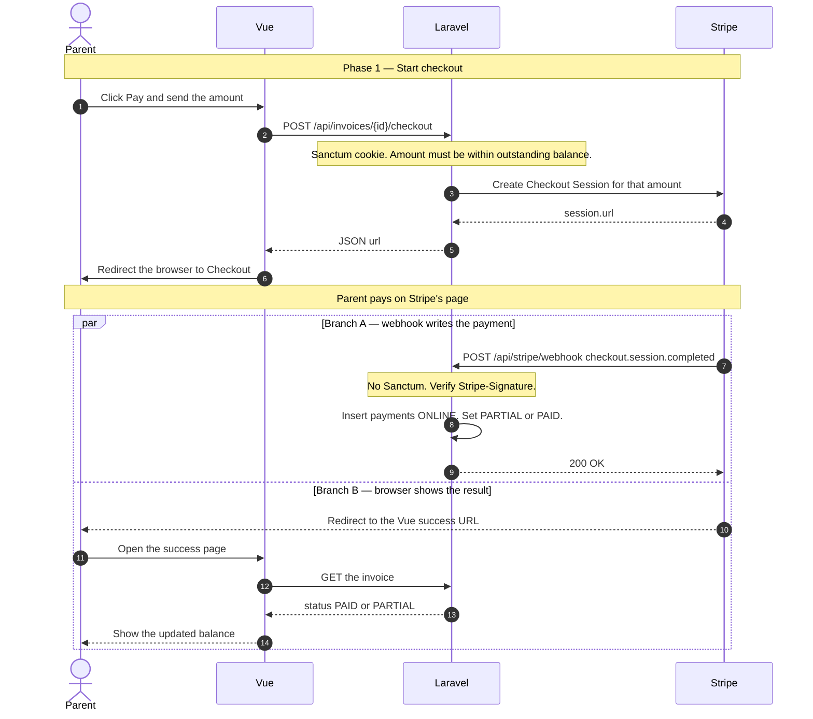
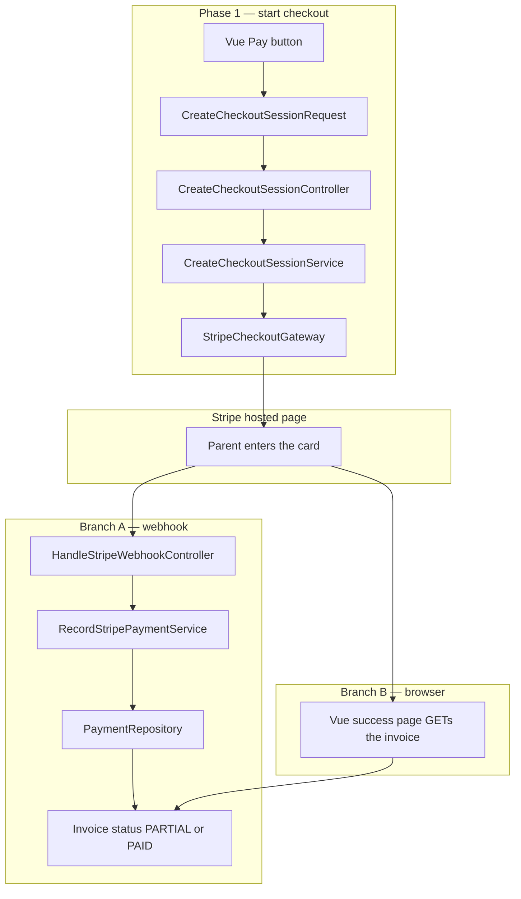
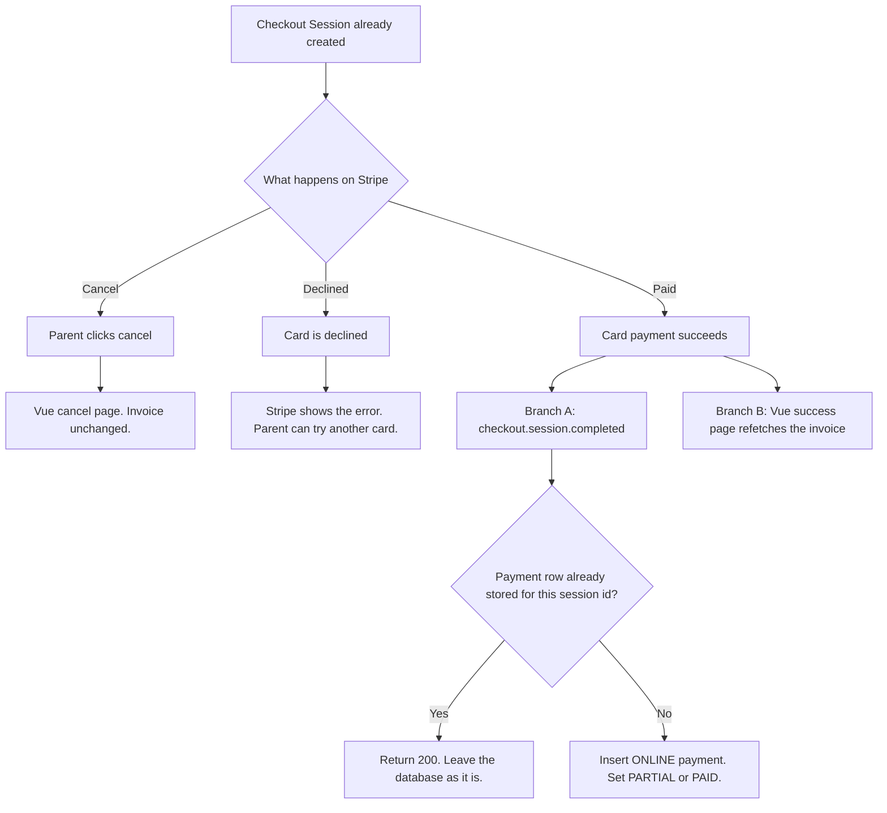

# Stripe Checkout — Hands-On Implementation Guide

> **Purpose:** Study guide for collecting school fee payments with Stripe Checkout. Your Laravel API creates the charge and records it. Your Vue app only starts checkout and shows the result page.
>
> **Stack:** Laravel 12, Sanctum (stateful SPA), Vue 3 in a separate project, `stripe/stripe-php`, Stripe Checkout (hosted payment page).
>
> **How to use this guide:** Follow the numbered sections in order. Install the tools in [2. What to install](#2-what-to-install), then read the decisions and the sequence. After that, read each class under [11. Class map](#11-class-map). The snippets show the shape of the code. They are illustrations for learning. This document does not add those classes to `app/`.

---

## 1. Decisions locked in for this app

School fees are one-time invoice payments. A parent or staff member pays all or part of an outstanding balance. That matches the existing fee module:

- [app/Enum/PaymentMethod.php](../app/Enum/PaymentMethod.php) — `CASH`, `BANK`, `ONLINE`
- [app/Enum/InvoiceStatus.php](../app/Enum/InvoiceStatus.php) — `UNPAID`, `PARTIAL`, `PAID`
- [app/Models/Invoice.php](../app/Models/Invoice.php) — `student()`, `invoiceItems()`, `payments()`
- [database/migrations/2025_12_02_134812_create_payments_table.php](../database/migrations/2025_12_02_134812_create_payments_table.php) — `invoice_id`, `amount_paid`, `method`, `paid_at`

**Use Stripe Checkout.** Stripe hosts the card page. Vue redirects the browser there. You do not build card inputs.

**Use `stripe/stripe-php` on Laravel.** Laravel Cashier fits subscription billing. This module is invoice payments, including partial payments, so a Checkout Session per payment attempt is the right tool.

**Laravel is the source of truth for money.** Vue asks Laravel to start a session. Stripe tells Laravel the payment finished, through a webhook. The webhook inserts the `payments` row (`method = ONLINE`) and updates the invoice status.

**Cash and bank stay manual.** Staff still record those payments in your own “Record Payment” flow. Stripe is only the `ONLINE` path.

**Vue lives in another project.** This guide describes what that app does. It does not invent Vue file paths in this repo.

Layout of new PHP classes follows the messaging feature: an invokable controller, a FormRequest, a service, and a repository bound in [app/Providers/RepositoryServiceProvider.php](../app/Providers/RepositoryServiceProvider.php). See [app/Http/Controllers/Message/SendMessageController.php](../app/Http/Controllers/Message/SendMessageController.php) and [app/Services/Message/SendMessageService.php](../app/Services/Message/SendMessageService.php).

---

## 2. What to install

Nothing in this repo includes Stripe yet. `composer.json` has no Stripe package. Install the pieces below before you write the classes.

### 2.1 Laravel package (required)

From the Laravel project:

```bash
composer require stripe/stripe-php
```

That is the only PHP library for this design. Leave **Laravel Cashier** out. Cashier is built for subscriptions. School fees here are one-time invoice payments, including partial amounts.

### 2.2 Stripe account and test keys (required)

Create an account at [dashboard.stripe.com](https://dashboard.stripe.com) and stay in **Test mode**.

| Put this in Laravel `.env` | Where you copy it from |
| --- | --- |
| `STRIPE_SECRET` | Developers → API keys → Secret key (`sk_test_...`) |
| `STRIPE_WEBHOOK_SECRET` | Leave empty during normal local work. Fill it only when you deliberately test the webhook. The CLI prints a `whsec_...` for that test. A deployed server uses the signing secret from the Dashboard webhook destination. |
| `STRIPE_CURRENCY` | Your choice, for example `php` |
| `STRIPE_SUCCESS_URL` | Your Vue success page |
| `STRIPE_CANCEL_URL` | Your Vue cancel page |

Keep `STRIPE_SECRET` and `STRIPE_WEBHOOK_SECRET` on the server. Vue never receives them.

### 2.3 Stripe CLI (not part of daily work)

Do not run `stripe listen` while you build this project. That matches the work app: the webhook route exists, and the Stripe sandbox has no local destination, so nobody forwards events to `localhost` during normal development.

Stripe’s servers cannot call `http://localhost`. Without a listener, a local test payment still opens Checkout and can charge a test card. `HandleStripeWebhookController` does not run, and the invoice stays `UNPAID`. The success page only refetches that status. It does not write a payment.

Install the [Stripe CLI](https://docs.stripe.com/stripe-cli) only on the day you want to test the webhook itself. Then:

```bash
stripe login
stripe listen --forward-to http://localhost:8000/api/stripe/webhook
```

Stop the command when that test is done. Full steps are in [13. Local webhook testing](#13-local-webhook-testing).

### 2.4 Vue

Install nothing from Stripe in the Vue project. Checkout is a full-page redirect, so this design does not use `@stripe/stripe-js`. The pay button calls your Laravel API and sets `window.location` to the URL Laravel returns.

---

## 3. Straight-to-the-point checklist

The payment has two phases. Phase 2 has two branches that run at the same time.

**Phase 1 — start checkout (you are still in your app)**

1. Parent clicks Pay. Vue `POST`s the invoice id and the amount to Laravel.
2. Laravel checks the outstanding balance and creates a Checkout Session for that exact amount.
3. Laravel returns `{ url }`. Vue redirects the browser to Stripe.

**Phase 2 — after the card succeeds (two branches, same moment)**

4. **Branch A, server.** Stripe `POST`s `checkout.session.completed` to Laravel. The webhook inserts one `payments` row (`ONLINE`) and sets the invoice to `PARTIAL` or `PAID`.
5. **Branch B, browser.** Stripe redirects the parent to the Vue success URL. That page `GET`s the invoice and displays the status Branch A wrote.

Branch B never writes a payment. If the parent cancels, only Branch B runs, and it opens the cancel URL. The invoice stays unchanged.

On your machine, Branch A does not run during normal work. `localhost` is invisible to Stripe, and you are not running `stripe listen`. The success page can load after a test card and still show `UNPAID`. That is expected. The invoice changes when Stripe can reach the webhook: a deployed URL with a Dashboard destination, or a one-off local listener test.

---

## 4. Who does what

| Layer | Job |
| --- | --- |
| Vue pay button | Calls Laravel, then redirects to the Checkout URL |
| `CreateCheckoutSessionRequest` | Validates `amount` |
| `CreateCheckoutSessionController` | Auth user, HTTP status, error log |
| `CreateCheckoutSessionService` | Outstanding balance, reject overpay, ask the gateway for a session |
| `StripeCheckoutGateway` | The only class that talks to the Stripe SDK |
| Stripe Checkout | Card form, 3-D Secure, charge |
| `HandleStripeWebhookController` | Public route, verify Stripe signature, no Sanctum |
| `RecordStripePaymentService` | Idempotent insert of `ONLINE` payment, update invoice status |
| `PaymentRepository` | Find-by-session and create the `payments` row |
| Vue success / cancel pages | Show a message and refetch the invoice |

---

## 5. Three keys, three jobs

Stripe gives you more than one key. Each key has one home.

| Key | Env name | Who may see it | What it does |
| --- | --- | --- | --- |
| Secret key | `STRIPE_SECRET` | Laravel only | Creates Checkout Sessions |
| Webhook signing secret | `STRIPE_WEBHOOK_SECRET` | Laravel only | Proves a webhook body really came from Stripe |
| Publishable key | `STRIPE_KEY` (optional here) | Safe in the browser | Used by Stripe.js when you embed Elements |

Checkout redirect does not need the publishable key in Vue, because Stripe hosts the page. Keep `STRIPE_SECRET` and `STRIPE_WEBHOOK_SECRET` on the server. A publishable key in the frontend cannot create a charge by itself, and it cannot replace the webhook.

Test keys start with `sk_test_` and `pk_test_`. Live keys start with `sk_live_` and `pk_live_`. Use test keys until a real card payment is intentional.

---

## 6. Amounts: your database vs Stripe

Your columns are decimal pesos (or whatever currency you configure), with two decimal places:

- `invoices.total_amount` — `decimal(10, 2)`
- `payments.amount_paid` — `decimal(10, 2)`

Stripe charges in the **smallest currency unit**. For currencies with two decimals (`usd`, `php`, `eur`), multiply by 100.

| Your amount | Stripe `unit_amount` |
| --- | --- |
| `1500.00` | `150000` |
| `99.50` | `9950` |

Store and compare money in your app as decimals. Convert only inside `StripeCheckoutGateway`, at the moment you call Stripe. Convert back when the webhook returns Stripe’s integer amount, before you write `amount_paid`.

A few currencies have no subunits (for example `jpy`). Those must not be multiplied by 100. `STRIPE_CURRENCY` in `.env` is the switch. This guide assumes a two-decimal currency. If you change currency, check Stripe’s currency list before changing the multiplier.

**Laravel chooses the amount.** The request body may say “pay 500 of this invoice.” The service computes:

```text
outstanding = invoice.total_amount - sum(payments.amount_paid)
```

If `amount` is missing, not numeric, `<= 0`, or greater than `outstanding`, reject the request. Stripe then charges exactly the amount Laravel put on the session.

---

## 7. Data you add

The current `payments` table has no Stripe id. Add one column so the same webhook cannot insert two rows:

| Column | Type | Why |
| --- | --- | --- |
| `stripe_checkout_session_id` | string, unique, nullable | Idempotency key for Checkout. Nullable so cash and bank rows stay valid. |

Cash and bank payments leave this column `null`. Online payments always set it.

From the Laravel project, create a **new** migration. Do not edit [database/migrations/2025_12_02_134812_create_payments_table.php](../database/migrations/2025_12_02_134812_create_payments_table.php) if that migration has already run.

```bash
php artisan make:migration add_stripe_checkout_session_id_to_payments_table --table=payments
```

Artisan prints a path like `database/migrations/2026_10_01_000000_add_stripe_checkout_session_id_to_payments_table.php`. Open that file and replace `up()` and `down()` with:

```php
public function up(): void
{
    Schema::table('payments', function (Blueprint $table) {
        $table->string('stripe_checkout_session_id')->nullable()->unique();
    });
}

public function down(): void
{
    Schema::table('payments', function (Blueprint $table) {
        $table->dropUnique(['stripe_checkout_session_id']);
        $table->dropColumn('stripe_checkout_session_id');
    });
}
```

Apply it:

```bash
php artisan migrate
```

There is no Artisan command for the model. Open [app/Models/Payment.php](../app/Models/Payment.php) and match [app/Models/Message.php](../app/Models/Message.php): this table has `created_at` and no `updated_at`, and `BaseRepository::create()` drops attributes that are not fillable.

```php
public $timestamps = false;

/**
 * @var list<string>
 */
protected $fillable = [
    'invoice_id',
    'amount_paid',
    'method',
    'paid_at',
    'stripe_checkout_session_id',
    'created_at',
];
```

Because timestamps are off, the webhook `create()` array must include `'created_at' => now()`.

---

## 8. Flowcharts

### 8.1 Happy path

Read the numbers top to bottom. Phase 1 is one straight line. Phase 2 splits: the webhook writes the database while the browser comes back to Vue. Those two branches do not wait for each other. The webhook often finishes first. Sometimes the success page loads first and the invoice is still `UNPAID` for a moment. The page refetches. It still does not insert a payment.



### 8.2 Which class runs when



Phase 1 never inserts a `payments` row. Branch A is the only writer. Branch B only reads `invoiceRow`.

### 8.3 Cancel, decline, and duplicate webhook



What each branch means:

- **Cancel.** Stripe redirects to `cancel_url`. No charge. No webhook that should create a payment. Invoice stays as it was. Vue shows “Payment cancelled” and the same outstanding balance.
- **Card declined.** Stripe shows the error on its own page. Your webhook for a completed paid session does not run. You do not write a failed attempt into `payments` unless you later decide you want that audit trail.
- **Duplicate webhook.** Stripe retries if your endpoint is slow or returns a non-2xx status. `RecordStripePaymentService` looks up `stripe_checkout_session_id` first. If the row exists, it returns success and does not insert again.
- **Success URL opened twice.** Refreshing the success page only refetches the invoice. It cannot double-charge, because the charge already happened, and it cannot double-insert, because Vue never inserts.

---

## 9. Routes

There is no Artisan command that registers a route. Open [routes/api.php](../routes/api.php) and add the `use` lines at the top, then the two routes below.

**Start checkout** — inside the existing `auth:sanctum` group, same style as the other API routes:

```php
Route::post(
    'invoices/{invoice}/checkout',
    CreateCheckoutSessionController::class,
)->name('invoices.checkout');
```

**Webhook** — outside `auth:sanctum`. Stripe has no session cookie and no CSRF token.

```php
Route::post('stripe/webhook', HandleStripeWebhookController::class)
    ->name('stripe.webhook');
```

[bootstrap/app.php](../bootstrap/app.php) turns on `statefulApi()` and only exempts `login` from CSRF today:

```php
$middleware->validateCsrfTokens(except: [
    'login',
]);
```

Add the webhook path to that list (`stripe/webhook` or `api/stripe/webhook`, matching how Laravel registers the API prefix). Stripe’s servers are not your SPA, so they cannot send the `X-XSRF-TOKEN` header your Vue app sends.

Return **HTTP 200** from the webhook after you handle it, including the duplicate case. A 500 makes Stripe retry. A retry is fine if your handler is idempotent. An endless retry loop means the handler is throwing.

Confirm both routes exist:

```bash
php artisan route:list --path=checkout
php artisan route:list --path=stripe
```

You should see `POST api/invoices/{invoice}/checkout` and `POST api/stripe/webhook`.

---

## 10. Config

There is no Artisan command for config. Open [config/services.php](../config/services.php) and `.env` (and `.env.example` so the keys are documented). After you save `.env`, clear cached config so Laravel reads the new values:

```bash
php artisan config:clear
```

```php
'stripe' => [
    'secret' => env('STRIPE_SECRET'),
    'webhook_secret' => env('STRIPE_WEBHOOK_SECRET'),
    'currency' => env('STRIPE_CURRENCY', 'php'),
    'success_url' => env('STRIPE_SUCCESS_URL'),
    'cancel_url' => env('STRIPE_CANCEL_URL'),
],
```

```dotenv
STRIPE_SECRET=sk_test_...
STRIPE_WEBHOOK_SECRET=whsec_...
STRIPE_CURRENCY=php
STRIPE_SUCCESS_URL=http://localhost:5173/fees/payment/success?session_id={CHECKOUT_SESSION_ID}
STRIPE_CANCEL_URL=http://localhost:5173/fees/payment/cancel
```

`{CHECKOUT_SESSION_ID}` is Stripe’s own placeholder. Stripe replaces it when it redirects. Your success page can read `session_id` to show “we’re confirming this payment,” then load the invoice from your API.

`success_url` and `cancel_url` point at the **Vue** origin, not at Laravel.

---

## 11. Class map

Read them in this order. Each one has a single reason to exist.

| Order | Class | Folder |
| --- | --- | --- |
| 11.1 | `StripeCheckoutGateway` | `app/Services/Payment/` |
| 11.2 | `CreateCheckoutSessionRequest` | `app/Http/Requests/Payment/` |
| 11.3 | `CreateCheckoutSessionService` | `app/Services/Payment/` |
| 11.4 | `CreateCheckoutSessionController` | `app/Http/Controllers/Payment/` |
| 11.5 | `PaymentInterface` | `app/Interfaces/` |
| 11.6 | `PaymentRepository` | `app/Repositories/` |
| 11.7 | `RecordStripePaymentService` | `app/Services/Payment/` |
| 11.8 | `HandleStripeWebhookController` | `app/Http/Controllers/Payment/` |

`RepositoryServiceProvider` already exists, so do not run `make:provider`. Open [app/Providers/RepositoryServiceProvider.php](../app/Providers/RepositoryServiceProvider.php) and add the binding next to the others:

```php
$this->app->bind(
    \App\Interfaces\PaymentInterface::class,
    \App\Repositories\PaymentRepository::class,
);
```

---

### 11.1 `StripeCheckoutGateway`

Create the class. Artisan builds the folder `app/Services/Payment/` if it is missing.

```bash
php artisan make:class Services/Payment/StripeCheckoutGateway
```

**Why it exists.** The Stripe SDK is a third-party client. If services call `\Stripe\StripeClient` directly, every class needs the secret key, the amount conversion, and the session field list. One gateway keeps that in one place. When you read a payment bug, you open this class to see the Stripe call, and the other service to see your invoice rules.

**What it knows.** `config('services.stripe.secret')`, currency, and how to turn `1500.00` into `150000`.

**What it does not know.** Outstanding balance, invoice status, or whether the user may pay this student. The service decides that before calling the gateway.

**Methods to learn.**

`createCheckoutSession(Invoice $invoice, string $amount): string`

- Build a Checkout Session in `mode: payment` (one-time), not `subscription`.
- `line_items[0].price_data.currency` comes from config.
- `line_items[0].price_data.unit_amount` is the integer minor units.
- `line_items[0].quantity` is `1`.
- `metadata` includes `invoice_id` so the webhook can find your row without trusting the success URL.
- `success_url` and `cancel_url` come from config.
- `client_reference_id` can also be the invoice id (string). Metadata is the one the webhook should read.
- Return `$session->url`. That is the only value Vue needs.

`constructWebhookEvent(string $payload, string $signatureHeader): \Stripe\Event`

- Call `\Stripe\Webhook::constructEvent($payload, $signatureHeader, $webhookSecret)`.
- If the signature is wrong, Stripe’s SDK throws. The controller turns that into HTTP 400.
- This is how you know the JSON was not typed by an attacker who discovered your URL.

Illustrative shape:

```php
class StripeCheckoutGateway
{
    public function createCheckoutSession(Invoice $invoice, string $amount): string
    {
        $stripe = new \Stripe\StripeClient(config('services.stripe.secret'));

        $session = $stripe->checkout->sessions->create([
            'mode' => 'payment',
            'success_url' => config('services.stripe.success_url'),
            'cancel_url' => config('services.stripe.cancel_url'),
            'client_reference_id' => (string) $invoice->id,
            'metadata' => [
                'invoice_id' => (string) $invoice->id,
            ],
            'line_items' => [[
                'quantity' => 1,
                'price_data' => [
                    'currency' => config('services.stripe.currency'),
                    'unit_amount' => $this->toMinorUnits($amount),
                    'product_data' => [
                        'name' => 'Invoice '.$invoice->invoice_no,
                    ],
                ],
            ]],
        ]);

        return $session->url;
    }
}
```

`toMinorUnits()` for a two-decimal currency:

```php
private function toMinorUnits(string $amount): int
{
    return (int) round(((float) $amount) * 100);
}
```

Use a decimal library later if you want to avoid binary float rounding. For learning, know that the conversion happens **here**, not in the controller and not in Vue.

---

### 11.2 `CreateCheckoutSessionRequest`

```bash
php artisan make:request Payment/CreateCheckoutSessionRequest
```

That writes `app/Http/Requests/Payment/CreateCheckoutSessionRequest.php`. Replace the generated `rules()` method with the one below.

**Why it exists.** Same job as [app/Http/Requests/Message/SendMessageRequest.php](../app/Http/Requests/Message/SendMessageRequest.php). It stops bad input before the service runs.

**Input.** JSON body `{ "amount": "500.00" }`. The invoice id is on the URL, not in the body.

**Rules.**

- `amount` — required, numeric, `gt:0`
- Optional max decimal places: `decimal:0,2` so `10.999` never reaches Stripe

**What it does not check.** It does not know the outstanding balance. That needs the invoice and its payments, which is the service’s job. Validation here is shape. Validation in the service is business rules.

```php
public function rules(): array
{
    return [
        'amount' => ['required', 'numeric', 'gt:0', 'decimal:0,2'],
    ];
}
```

`authorize()` can stay `true` if the controller already sits behind `auth:sanctum`. A later policy can restrict who may pay which invoice (parent of that student, or staff).

---

### 11.3 `CreateCheckoutSessionService`

```bash
php artisan make:class Services/Payment/CreateCheckoutSessionService
```

**Why it exists.** The controller stays thin. This class is the place for fee rules.

**Constructor.** Inject `StripeCheckoutGateway`. Invoice loading can use the `Invoice` model directly until you add an `InvoiceRepository`. Payment history is already on `$invoice->payments()`.

**Method.** `handle(Invoice $invoice, string $amount): string`

Steps, in order:

1. Load payments if they are not loaded: `$invoice->loadMissing('payments')`.
2. Sum `amount_paid`.
3. `outstanding = total_amount - paid`.
4. If `amount` is greater than `outstanding`, throw a validation exception (`422`). The parent cannot pay more than what is left. This is the same rule as the fee epic: payments must not exceed the outstanding balance.
5. If `outstanding` is `0`, the invoice is already paid. Reject.
6. Call `$gateway->createCheckoutSession($invoice, $amount)`.
7. Return the URL.

**What it does not do.** It does not insert a `payments` row. The parent has not paid yet. A Checkout Session is a permission slip for Stripe to charge that amount. The row is written only after Stripe confirms payment.

**Partial payments.** If the invoice total is `1000` and they send `amount: 400`, the session is for `400`. After the webhook, status becomes `PARTIAL`. A second Pay click later creates a **new** session for whatever is still outstanding (or a smaller amount they choose). One session, one payment row.

Illustrative shape:

```php
public function handle(Invoice $invoice, string $amount): string
{
    $invoice->loadMissing('payments');

    $paid = $invoice->payments->sum('amount_paid');
    $outstanding = bcsub((string) $invoice->total_amount, (string) $paid, 2);

    if (bccomp($outstanding, '0', 2) !== 1) {
        throw ValidationException::withMessages([
            'amount' => 'This invoice has no outstanding balance.',
        ]);
    }

    if (bccomp($amount, $outstanding, 2) === 1) {
        throw ValidationException::withMessages([
            'amount' => 'Amount cannot exceed the outstanding balance.',
        ]);
    }

    return $this->gateway->createCheckoutSession($invoice, $amount);
}
```

`bccomp` / `bcsub` compare decimals as strings. That avoids float errors on money. Enable the PHP `bcmath` extension (it is normal on Laravel hosts). If you prefer, compare with a decimal helper. Do not compare money with raw `>` on floats.

---

### 11.4 `CreateCheckoutSessionController`

`--invokable` gives you a single `__invoke` method, the same shape as `SendMessageController`.

```bash
php artisan make:controller Payment/CreateCheckoutSessionController --invokable
```

**Why it exists.** HTTP only. Same pattern as `SendMessageController`: constructor injection, `__invoke`, try/catch, `LogService::error`, JSON response.

**Route model binding.** `{invoice}` resolves an `Invoice`. Unknown ids return 404 before your code runs.

**Method.** `__invoke(CreateCheckoutSessionRequest $request, Invoice $invoice): JsonResponse`

Steps:

1. Read the authenticated user if you need an audit log. `abort_if(! $user instanceof User, 401)` matches the type-narrowing used in `SendMessageController` for PHPStan.
2. `$url = $this->service->handle($invoice, $request->validated('amount'))`.
3. Return `200` with `{ "success": true, "data": { "url": $url } }`.
4. On exception, log with `LogService::error` and return `500`, except validation exceptions, which Laravel already renders as `422`.

**What it does not do.** It does not calculate outstanding balance. It does not call Stripe. If you see `new \Stripe\StripeClient` in a controller, the gateway boundary has leaked.

```php
public function __invoke(CreateCheckoutSessionRequest $request, Invoice $invoice): JsonResponse
{
    try {
        $url = $this->createCheckoutSessionService->handle(
            $invoice,
            (string) $request->validated('amount'),
        );

        return response()->json([
            'success' => true,
            'data' => ['url' => $url],
        ]);
    } catch (ValidationException $error) {
        throw $error;
    } catch (\Exception $error) {
        LogService::error('Error creating Stripe Checkout session.', [
            'invoice_id' => $invoice->id,
            'error' => $error->getMessage(),
        ]);

        return response()->json([
            'success' => false,
            'message' => 'Internal server error. Try again later.',
        ], Response::HTTP_INTERNAL_SERVER_ERROR);
    }
}
```

Re-throwing `ValidationException` lets Laravel’s handler send `422` with the field message. Swallowing it inside the generic `catch (\Exception $error)` would hide a user error as a 500.

---

### 11.5 `PaymentInterface`

`make:interface` puts the file under `app/` using the path you pass. This project keeps interfaces in `app/Interfaces/`.

```bash
php artisan make:interface Interfaces/PaymentInterface
```

**Why it exists.** Services depend on the interface. The provider binds the Eloquent repository. That matches `MessageInterface` and the other bindings in `RepositoryServiceProvider`.

**Methods this feature needs.**

```php
interface PaymentInterface
{
    /**
     * @param array<string, mixed> $data
     */
    public function create(array $data): Payment;

    public function findByCheckoutSessionId(string $sessionId): ?Payment;
}
```

`findByCheckoutSessionId` is the idempotency lookup. `create` writes the row.

You can extend `BaseInterface` if you want `find` / `update` later. Start with the two methods the webhook actually calls.

---

### 11.6 `PaymentRepository`

```bash
php artisan make:class Repositories/PaymentRepository
```

**Why it exists.** Eloquent queries stay out of the webhook service. Same pattern as [app/Repositories/MessageRepository.php](../app/Repositories/MessageRepository.php): extend `BaseRepository`, implement the interface, pass `Payment` into the parent constructor.

```php
class PaymentRepository extends BaseRepository implements PaymentInterface
{
    public function __construct(Payment $model)
    {
        parent::__construct($model);
    }

    public function findByCheckoutSessionId(string $sessionId): ?Payment
    {
        return $this->model
            ->newQuery()
            ->where('stripe_checkout_session_id', $sessionId)
            ->first();
    }

    public function create(array $data): Payment
    {
        /** @var Payment $payment */
        $payment = parent::create($data);

        return $payment;
    }
}
```

`create` must persist `method` as `PaymentMethod::ONLINE->value` (`ONLINE`), which matches the enum column. Your enum values are uppercase. The docs in `docs/Database Schema` say `cash, bank, online` in lowercase. Trust the enum and the migration, which use `PaymentMethod::list()`.

---

### 11.7 `RecordStripePaymentService`

```bash
php artisan make:class Services/Payment/RecordStripePaymentService
```

**Why it exists.** This is the only class allowed to turn a Stripe event into a `payments` row and a new invoice status.

**Constructor.** Inject `PaymentInterface`. Use the `Invoice` model to load and update status (there is no invoice repository yet).

**Method.** `handle(\Stripe\Checkout\Session $session): void`

Steps, in order:

1. Ignore the event unless `$session->payment_status === 'paid'`. A completed session can still be `unpaid` for some delayed payment methods. Card payments you care about are `paid`.
2. Read `invoice_id` from `$session->metadata->invoice_id`. If it is missing, log and return. Do not guess.
3. If `findByCheckoutSessionId($session->id)` returns a model, return immediately. This is the duplicate webhook.
4. Load the invoice or fail with a log if it was deleted.
5. Convert `amount_total` (minor units) back to a two-decimal string. Prefer this amount over the amount you originally requested, because it is what Stripe actually collected. They should match.
6. Re-check outstanding balance inside a DB transaction. If this payment would exceed outstanding, log and stop. That guards a double-click that created two sessions.
7. `create` the payment:
   - `invoice_id`
   - `amount_paid`
   - `method` = `PaymentMethod::ONLINE`
   - `paid_at` = now
   - `stripe_checkout_session_id` = `$session->id`
   - `created_at` = now (the model has `$timestamps = false`)
8. Recompute paid total. If it equals `total_amount`, set status `PAID`. If it is greater than 0 and less than total, set `PARTIAL`.

Wrap steps 6–8 in `DB::transaction`. The unique index on `stripe_checkout_session_id` is the backstop if two webhook deliveries pass the “find existing” check at the same time. Catch the unique constraint violation and treat it as “already recorded.”

**What it does not do.** It does not trust the Vue success page. It does not mark the invoice paid because the browser came back. If this method never runs, the invoice stays `UNPAID` even if the parent saw a Stripe receipt. During normal local work that is the expected result, because Stripe cannot call `localhost`. On a deployed server, a Dashboard webhook destination is what makes this method run.

Illustrative core:

```php
public function handle(Session $session): void
{
    if ($session->payment_status !== 'paid') {
        return;
    }

    $existing = $this->paymentRepository->findByCheckoutSessionId($session->id);

    if ($existing instanceof Payment) {
        return;
    }

    $invoiceId = (int) ($session->metadata->invoice_id ?? 0);
    $invoice = Invoice::query()->find($invoiceId);

    if (! $invoice instanceof Invoice) {
        LogService::error('Stripe webhook invoice missing.', [
            'session_id' => $session->id,
            'invoice_id' => $invoiceId,
        ]);

        return;
    }

    $amount = number_format(((int) $session->amount_total) / 100, 2, '.', '');

    DB::transaction(function () use ($invoice, $session, $amount): void {
        $this->paymentRepository->create([
            'invoice_id' => $invoice->id,
            'amount_paid' => $amount,
            'method' => PaymentMethod::ONLINE->value,
            'paid_at' => now(),
            'stripe_checkout_session_id' => $session->id,
            'created_at' => now(),
        ]);

        $paid = $invoice->payments()->sum('amount_paid');
        $invoice->status = bccomp((string) $paid, (string) $invoice->total_amount, 2) === 0
            ? InvoiceStatus::PAID->value
            : InvoiceStatus::PARTIAL->value;
        $invoice->save();
    });
}
```

`payments()` sum inside the transaction includes the row you just inserted. Compare with `bccomp` so `1000.00` and `1000` count as equal.

---

### 11.8 `HandleStripeWebhookController`

```bash
php artisan make:controller Payment/HandleStripeWebhookController --invokable
```

**Why it exists.** Stripe calls this URL itself. There is no logged-in user. Sanctum must not wrap this route. The controller’s only jobs are: read the raw body, verify the signature, dispatch the one event you handle, return 200.

**Method.** `__invoke(Request $request): Response`

Steps:

1. `$payload = $request->getContent()`. Use the raw body. Parsing JSON first and re-encoding it can break the signature.
2. `$signature = $request->header('Stripe-Signature')`. If the header is missing, return `400`.
3. `$event = $this->gateway->constructWebhookEvent($payload, $signature)`.
4. If event type is `checkout.session.completed`, cast the object to a Checkout Session and call `RecordStripePaymentService::handle`.
5. For every other event type, return `200` and do nothing. Stripe sends many event types. You only subscribed, mentally, to the one that means “checkout finished.”
6. Signature failure returns `400`. Unexpected exceptions get `LogService::error` and `500`.

```php
public function __invoke(Request $request): Response
{
    $signature = $request->header('Stripe-Signature');

    if (! is_string($signature) || $signature === '') {
        return response('Missing signature.', Response::HTTP_BAD_REQUEST);
    }

    try {
        $event = $this->gateway->constructWebhookEvent(
            $request->getContent(),
            $signature,
        );
    } catch (\UnexpectedValueException | SignatureVerificationException $error) {
        LogService::error('Invalid Stripe webhook.', [
            'error' => $error->getMessage(),
        ]);

        return response('Invalid payload.', Response::HTTP_BAD_REQUEST);
    }

    if ($event->type === 'checkout.session.completed') {
        /** @var \Stripe\Checkout\Session $session */
        $session = $event->data->object;
        $this->recordStripePaymentService->handle($session);
    }

    return response('OK', Response::HTTP_OK);
}
```

**Why signature verification matters.** Anyone who can reach `/api/stripe/webhook` could POST fake JSON saying `payment_status: paid`. Without `constructEvent`, that fake body would mark an invoice paid. The signing secret is what makes the body trustworthy.

---

<!-- Todo -->
## 12. Vue app (separate project)

These screens live in the Vue repo, so none of the `php artisan` commands apply there. Add the pay button and the two routes in that project the same way you add any other page.

Vue has three screens in this flow. Names below are responsibilities, not required filenames.

### 12.1 Pay action

Shown on an unpaid or partial invoice.

1. User enters an amount, or you default it to the outstanding balance.
2. `POST /api/invoices/{id}/checkout` with the Sanctum cookie / CSRF header you already use for other API calls.
3. Read `response.data.data.url`.
4. `window.location.href = url`.

The browser leaves your app and opens Stripe. You do not mount a card form.

If Laravel returns `422`, show the validation message (“amount cannot exceed outstanding”). Leave the user on your page.

### 12.2 Success page

Route that matches `STRIPE_SUCCESS_URL` (path `/fees/payment/success` in the example).

1. Read `session_id` from the query string if you want to display it.
2. You still need the invoice id. Put it in the success URL yourself when you create the session (Stripe allows extra query params beside `{CHECKOUT_SESSION_ID}`), or look up by session id with a small authenticated Laravel endpoint later. The webhook does not need this page to know the invoice id. Metadata already has it.
3. `GET` the invoice from Laravel.
4. Show paid, partial, or “confirming payment” based on `status`.
5. Do not `POST` a payment from this page.

### 12.3 Cancel page

Route that matches `STRIPE_CANCEL_URL`.

1. Tell the user the payment was cancelled.
2. Link back to the invoice.
3. Outstanding balance is unchanged.

### 12.4 What Vue never stores

- `STRIPE_SECRET`
- `STRIPE_WEBHOOK_SECRET`
- A decision that the invoice is paid, unless the invoice `GET` says so after the webhook

---

## 13. Local webhook testing

Skip this section for normal work. Building Checkout, the Vue redirect, and the webhook class does not require `stripe listen`. The work project follows the same rule: the route is in Laravel, and the sandbox has no local listener running.

Use this only when you want to prove `HandleStripeWebhookController` inserts a payment on your machine.

Stripe cannot reach `http://localhost` from the internet. For this test, the Stripe CLI forwards events to your machine.

1. Install the [Stripe CLI](https://stripe.com/docs/stripe-cli).
2. `stripe login`.
3. Start Laravel (`php artisan serve` or your Docker URL).
4. Forward events:

```bash
stripe listen --forward-to http://localhost:8000/api/stripe/webhook
```

5. The CLI prints a webhook signing secret (`whsec_...`). Put that value in `STRIPE_WEBHOOK_SECRET` for this test. It is different from the secret in the Stripe Dashboard.
6. Trigger a test card payment through Checkout, or:

```bash
stripe trigger checkout.session.completed
```

`stripe trigger` builds a generic fixture. Your handler expects `metadata.invoice_id` and a real invoice row. A full test is: create an invoice in your database, click Pay in Vue, use card `4242 4242 4242 4242`, any future expiry, any CVC. Then confirm one `payments` row and the invoice status.

Watch Laravel logs if the webhook returns 400. The usual cause is the wrong `STRIPE_WEBHOOK_SECRET` (Dashboard secret vs CLI secret).

Stop `stripe listen` when the test is finished. Clear or ignore the CLI `whsec_...` value until the next webhook test. Day-to-day local Checkout does not use it.

---

## 14. End-to-end story with numbers

Invoice `INV-100` for student Ana. `total_amount = 1000.00`. Status `UNPAID`. No payments.

1. Parent submits amount `400.00`.
2. Service: outstanding `1000.00`, `400.00` is allowed.
3. Gateway creates a session with `unit_amount` `40000`, metadata `invoice_id = 15`.
4. Vue redirects to `https://checkout.stripe.com/...`.
5. Parent pays with the test card.
6. On `localhost`, during normal work, the webhook does not run. The success page refetches and still shows `UNPAID`. No `payments` row yet.
7. When Stripe can reach Laravel (deployed destination, or a one-off `stripe listen` test), the webhook runs. No existing session id. Insert `amount_paid = 400.00`, `method = ONLINE`, `stripe_checkout_session_id = cs_test_...`.
8. Paid sum `400.00` is below `1000.00`. Status becomes `PARTIAL`. The next invoice refetch shows `PARTIAL`, outstanding `600.00`.
9. Parent pays `600.00` later. That is a **new** Checkout Session and a **second** payment row.
10. Paid sum `1000.00`. Status becomes `PAID`.

A staff cash payment of `100.00` in between uses your manual flow, `method = CASH`, `stripe_checkout_session_id = null`. The next online payment’s outstanding check includes that cash row, because outstanding is the sum of **all** payments.

---

## 15. Implementation order when you start coding

Do [2. What to install](#2-what-to-install) first. Leave the Stripe CLI uninstalled until you choose to test the webhook.

1. Package:

```bash
composer require stripe/stripe-php
```

2. Put the keys from [10. Config](#10-config) into `.env`, then:

```bash
php artisan config:clear
```

3. Column and model, from [7. Data you add](#7-data-you-add):

```bash
php artisan make:migration add_stripe_checkout_session_id_to_payments_table --table=payments
php artisan migrate
```

4. Classes. Run these, then fill each file using [11. Class map](#11-class-map):

```bash
php artisan make:class Services/Payment/StripeCheckoutGateway
php artisan make:request Payment/CreateCheckoutSessionRequest
php artisan make:class Services/Payment/CreateCheckoutSessionService
php artisan make:controller Payment/CreateCheckoutSessionController --invokable
php artisan make:interface Interfaces/PaymentInterface
php artisan make:class Repositories/PaymentRepository
php artisan make:class Services/Payment/RecordStripePaymentService
php artisan make:controller Payment/HandleStripeWebhookController --invokable
```

5. Edit `RepositoryServiceProvider`, [routes/api.php](../routes/api.php), and the CSRF exception in [bootstrap/app.php](../bootstrap/app.php). Then:

```bash
php artisan route:list --path=checkout
php artisan route:list --path=stripe
```

6. In the Vue project, add the pay redirect plus the success and cancel pages from [12. Vue app (separate project)](#12-vue-app-separate-project).

Build the checkout controller and the webhook controller in the same sitting so the webhook class exists, the same way the work app has `EventWebhookController` even without a local listener. A local test card still leaves the invoice `UNPAID` until Stripe delivers `checkout.session.completed`. Do not add a success-page writer to fill that gap. Run [13. Local webhook testing](#13-local-webhook-testing) only when you want to see the insert happen on your machine.

---

## 16. Study questions

Answer these before you write the classes. If you can answer them, you understand the integration.

1. Which key is allowed in Vue, and which two stay in `.env`?
2. Why does `CreateCheckoutSessionService` return before any `payments` insert?
3. Why is the webhook outside `auth:sanctum`?
4. What column stops a retried webhook from inserting a second payment?
5. Who sets `unit_amount`: Vue, Laravel, or Stripe?
6. After a successful card payment, which HTTP call changes `invoices.status`?
7. What should the success page do if the invoice is still `UNPAID`?
8. How does a later cash payment change the next Checkout amount?
